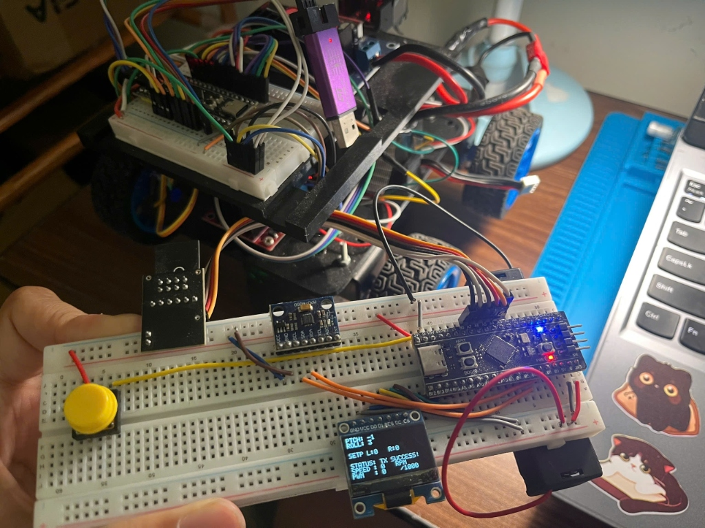
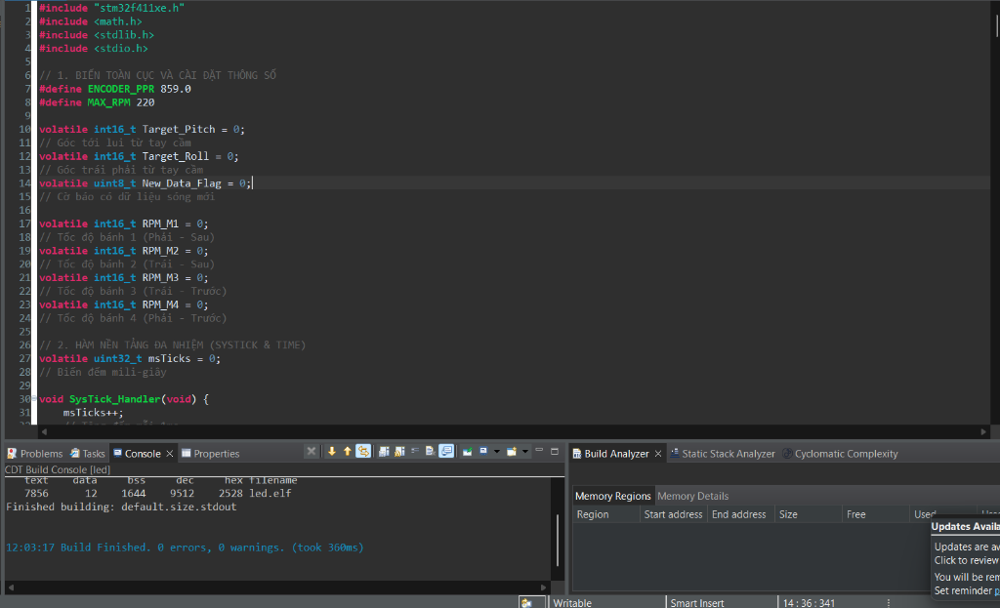

# 🚗 STM32 Closed-Loop PID Gesture-Controlled 4WD Robot


-brightgreen.svg)


> **Môn học:** Nhập môn Hệ thống nhúng (ELT3240_2) – Trường Đại học Công nghệ, ĐHQGHN (VNU-UET).  
> **Đề tài:** Thiết kế và thực hiện hệ thống điều khiển xe robot bằng cử chỉ tay sử dụng STM32 và PID vòng kín.  
> **Giảng viên phụ trách:** ThS. Phạm Đình Tuân, KS. Đỗ Đình Minh.  

---

## 📸 Hình ảnh thực nghiệm hệ thống

| Khối Xe Robot & Tay Cầm Điều Khiển | Biên dịch phần mềm trên STM32CubeIDE |
| :---: | :---: |
|  |  |
| *Màn hình OLED hiển thị Telemetry thời gian thực (`TX SUCCESS!`, góc nghiêng Pitch/Roll, tốc độ RPM và xung PWM)* | *Mã nguồn Bare-metal biên dịch thành công 0 errors, 0 warnings* |

---

## 👥 Thành viên nhóm
| Họ và tên | Mã sinh viên | Vai trò & Đóng góp |
| :--- | :---: | :--- |
| **Nguyễn Tiến Đạt** | **24022854** | **Nhóm trưởng**: Kiến trúc phần mềm điều khiển khối Xe, lập trình bộ điều khiển 4 vòng lặp PID rời rạc, giải mã Encoder phần cứng 4 kênh (X4 Mode), giải thuật động học vi sai Skid-Steer và cơ chế Co tỷ lệ (Scale Factor). |
| **Lê Xuân Thành** | **24022910** | Lập trình khối Tay cầm cử chỉ (đọc cảm biến gia tốc MPU6050 qua $I^2C1$, hiển thị đồ họa OLED SSD1306 qua SPI2) và giao thức truyền thông vô tuyến hai chiều NRF24L01+. |
| **Phạm Văn Sơn** | **24021958** | Thiết kế sơ đồ nguyên lý phần cứng, ma trận phân bổ chân GPIO/AF, thi công lắp ráp cơ khí khung xe 4WD và xây dựng các cơ chế an toàn chủ động (Failsafe ngắt sóng, Stall Protection chống kẹt cơ khí). |

---

## 🌟 Điểm nổi bật về mặt kỹ thuật

1. **Lập trình Bare-Metal C hiệu năng cao:**
   - Thao tác trực tiếp trên các thanh ghi phần cứng của vi điều khiển **STM32F411CEU6** (lõi ARM Cortex-M4, xung nhịp 16 MHz).
   - Không sử dụng thư viện HAL cồng kềnh, tối ưu hóa tuyệt đối thời gian thực với chu kỳ dòng quét chính xác $10\text{ ms}$ ($100\text{ Hz}$).
2. **Giải mã Encoder phần cứng 4 kênh (X4 Mode):**
   - Tận dụng đồng thời 4 bộ Timer phần cứng riêng biệt (`TIM1`, `TIM2`, `TIM3`, `TIM4`) ở chế độ `Encoder Mode 3`.
   - Đạt độ phân giải đo lường cực cao: **$859\text{ xung/vòng}$** mà không tiêu tốn tài nguyên ngắt CPU.
3. **Vòng lặp kín 4 bộ PID rời rạc tích hợp Anti-Windup & Lọc số thông thấp:**
   - Bộ điều khiển 4 bánh độc lập, triệt tiêu sai số xác lập: $e_{ss} \le 1.81\%$.
   - Tích hợp khâu chống bão hòa tích phân (Anti-windup kẹp giới hạn $[-2000, 2000]$) và bộ lọc số thông thấp ngõ ra PWM ($\alpha = 0.3$), loại bỏ hoàn toàn độ vọt lố ($Overshoot \approx 0\%$).
4. **Động học vi sai Skid-Steer với cơ chế Co tỷ lệ (Scale Factor):**
   - Tự động co cụm tỷ lệ phân bổ Setpoint cho 2 sườn bánh xe khi vượt ngưỡng vật lý $MAX\_RPM = 220$, giữ chuẩn bán kính vòng cua và quỹ đạo rẽ ở tốc độ cao.
5. **Truyền thông vô tuyến 2 chiều NRF24L01 kết hợp ngắt ngoài EXTI10:**
   - Băng tần 2.440 GHz (Kênh 40), tốc độ 1 Mbps.
   - Cơ chế ngắt ngoài `EXTI10` (`PB10`) trên xe bắt gói tin tức thời, không làm trễ chu kỳ điều khiển.
   - Tính năng **Live Telemetry**: Xe đóng gói tốc độ thực tế (RPM) vào gói phản hồi `Auto-ACK` gửi ngược về tay cầm hiển thị lên màn hình OLED.
6. **Hệ thống an toàn chủ động đa tầng:**
   - *Failsafe:* Tự động dừng 4 bánh xe sau $500\text{ ms}$ mất sóng; tự động tái khởi động mềm chip sóng (Auto-Recover) chống nhiễu điện từ.
   - *Stall Protection:* Nhận diện hiện tượng kẹt bánh xe cơ khí để ngắt điện toàn phần và kích hoạt đèn SOS (`PC13`), bảo vệ an toàn mạch công suất Driver L298N.

---

## 📐 Sơ đồ phân bổ chân ngoại vi (Pinout)

### 1. Khối Xe Robot (Receiver & Actuator)
| Ngoại vi / Linh kiện | Chân STM32 | Chức năng phần cứng |
| :--- | :---: | :--- |
| **PWM Động cơ 1 - 4** | `PA0`, `PA1`, `PA2`, `PA3` | `TIM5_CH1..4` (AF2) – Băm xung PWM 1 kHz, độ phân giải 1000 bước |
| **Chiều Bánh 1 (Phải - Sau)** | `PB12`, `PB13` | GPIO Output Push-Pull |
| **Chiều Bánh 2 (Trái - Sau)** | `PB14`, `PB15` | GPIO Output Push-Pull |
| **Chiều Bánh 3 (Trái - Trước)** | `PA10`, `PA11` | GPIO Output Push-Pull |
| **Chiều Bánh 4 (Phải - Trước)** | `PA12`, `PB8` | GPIO Output Push-Pull |
| **Encoder Bánh 1** | `PA8`, `PA9` | `TIM1_CH1`, `TIM1_CH2` (AF1) – Encoder Mode X4 |
| **Encoder Bánh 2** | `PA15`, `PB3` | `TIM2_CH1`, `TIM2_CH2` (AF1) – Encoder Mode X4 |
| **Encoder Bánh 3** | `PB4`, `PB5` | `TIM3_CH1`, `TIM3_CH2` (AF2) – Encoder Mode X4 |
| **Encoder Bánh 4** | `PB6`, `PB7` | `TIM4_CH1`, `TIM4_CH2` (AF2) – Encoder Mode X4 |
| **NRF24L01 SPI1** | `PA5`, `PA6`, `PA7` | `SPI1_SCK`, `SPI1_MISO`, `SPI1_MOSI` (AF5) |
| **NRF24L01 CE / CSN** | `PB0`, `PB1` | GPIO Output Push-Pull |
| **NRF24L01 IRQ** | `PB10` | `EXTI10` (Ngắt ngoài sườn âm) |
| **LED Báo trạng thái / SOS** | `PC13` | GPIO Output Push-Pull |

### 2. Khối Tay Cầm Điều Khiển (Transmitter)
| Ngoại vi / Linh kiện | Chân STM32 | Chức năng phần cứng |
| :--- | :---: | :--- |
| **Cảm biến MPU6050** | `PB6` (SCL), `PB7` (SDA) | `I2C1` (AF4) – 100 kHz, Open-Drain có Pull-up |
| **OLED SSD1306 SPI2** | `PB13` (SCK), `PB15` (MOSI) | `SPI2` (AF5) – Master Mode |
| **OLED Control Pins** | `PA8` (CS), `PB12` (RES), `PB14` (DC) | GPIO Output Push-Pull |
| **NRF24L01 SPI1** | `PA5` (SCK), `PA6` (MISO), `PA7` (MOSI) | `SPI1` (AF5) – Master Mode |
| **NRF24L01 CE / CSN** | `PA3` (CE), `PA4` (CSN) | GPIO Output Push-Pull |
| **Nút nhấn Start/Stop** | `PA0` | Digital Input có Pull-up nội bộ |

---

## 📊 Kết quả kiểm chứng thực nghiệm

| Chỉ tiêu kỹ thuật | Yêu cầu thiết kế | Kết quả đạt được | Đánh giá |
| :--- | :---: | :---: | :---: |
| **Thời gian tăng tốc ($Rise\ time$)** | $< 1.0\text{ s}$ | **$< 0.45\text{ s}$** | Xuất sắc |
| **Thời gian xác lập ($Settling\ time$)** | $\le 2.0\text{ s}$ | **$0.66\text{ s}$** | Xuất sắc |
| **Độ vọt lố ($Overshoot$)** | $< 10\%$ | **$\approx 0\%$** | Triệt tiêu hoàn toàn |
| **Sai số xác lập tĩnh ($e_{ss}$)** | $\le 2.0\%$ | **$1.81\%$** | Đạt chuẩn nâng cao |
| **Chu kỳ vòng điều khiển** | $10\text{ ms}$ | $10\text{ ms} \pm 0.1\%$ | Ổn định tuyệt đối |

---

## 📂 Cấu trúc thư mục mã nguồn

```text
STM32-Gesture-Controlled-Robot-PID/
├── Car_Controller/              # Dự án STM32CubeIDE cho Khối Xe Robot
│   ├── Core/
│   │   ├── Inc/                 # Header files (stm32f4xx_it.h, main.h...)
│   │   └── Src/
│   │       ├── main.c           # Chương trình điều khiển lõi: PWM, Encoder, PID, Skid-Steer, Failsafe
│   │       └── stm32f4xx_it.c   # Quản lý ngắt hệ thống
│   ├── Drivers/                 # Thư viện CMSIS Cortex-M4
│   ├── Car_Controller.ioc       # File cấu hình cấu trúc STM32CubeMX
│   └── STM32F411CEUX_FLASH.ld   # Linker script cho bộ nhớ Flash
├── Handheld_Transmitter/        # Dự án STM32CubeIDE cho Khối Tay Cầm Điều Khiển
│   ├── Core/
│   │   ├── Inc/
│   │   └── Src/
│   │       ├── main.c           # Đọc MPU6050, hiển thị OLED SSD1306, phát sóng RF NRF24L01
│   │       └── stm32f4xx_it.c
│   ├── Drivers/
│   └── STM32F411CEUX_FLASH.ld
├── Images/                      # Hình ảnh thực nghiệm mô hình và kết quả đo đạc
└── README.md                    # Tài liệu tổng quan dự án
```

---

## 🚀 Hướng dẫn nạp và chạy chương trình

1. **Phần mềm yêu cầu:** [STM32CubeIDE](https://www.st.com/en/development-tools/stm32cubeide.html) (phiên bản $\ge 1.14.0$).
2. **Mở dự án:**
   - Khởi động STM32CubeIDE $\to$ `File` $\to$ `Open Projects from File System...` $\to$ Trỏ đến thư mục `Car_Controller` hoặc `Handheld_Transmitter`.
3. **Biên dịch:**
   - Nhấn `Ctrl + B` (Build All) để biên dịch mã nguồn (kết quả: `0 errors, 0 warnings`).
4. **Nạp code:**
   - Kết nối mạch nạp ST-Link V2 với bo STM32 Black Pill (`3.3V`, `GND`, `SWDIO`, `SWCLK`).
   - Bấm nút **Run** (biểu tượng tam giác xanh) để nạp firmware vào vi điều khiển.

---

## 📜 Giấy phép (License)
Dự án được phân phối dưới giấy phép **MIT License**.
